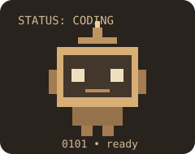

 

## About Me

I'm **Rodina**, a Computer Science student at **Egyptian Chinese University**, passionate about building practical **AI, Machine Learning, and data-driven systems**.

I enjoy working on the full journey of a project — from data preparation and model development to APIs, deployment, and usable products. My interests currently center around **AI systems, ML engineering, real-time analytics, and data pipelines**.

## Tech Stack

  
  
  
  
  
  
  
  
  
  

## Featured Projects

<table>
<tr>
<td width="33%" valign="top">
<strong>Intelligent Student Performance System (ISPS)</strong>

<small>Agentic academic-risk prediction combining Fuzzy C-Means, SVM, SHAP explanations, and drift detection with FastAPI.</small>

</td>
<td width="33%" valign="top">
<strong>Real-Time Traffic Analytics</strong>

<small>Traffic intelligence using Azure streaming, XGBoost and Streamlit to monitor and forecast congestion in Cairo.</small>

</td>
<td width="33%" valign="top">
<strong>Real-Time Big Data Fraud Detection</strong>

<small>Real-time fraud analytics pipeline using Kafka, Flume, Cassandra, Docker and Databricks.</small>

</td>
</tr>
</table>

<b>Also built · Social Media Fake Profile Detector</b>

 
Machine learning project focused on identifying potentially fake social media accounts using feature engineering and classification.
  

## Current Focus

- Building **reliable AI systems** that go beyond model demos.
- Improving my skills in **ML engineering** and **data-intensive applications**.
- Exploring practical ways to turn intelligent systems into useful products.

## GitHub Activity

  

## Let's Connect

I'm open to opportunities, collaborations, and conversations about **AI, Machine Learning, and practical engineering**.

[LinkedIn](https://www.linkedin.com/in/rodina-sabry-b79b95354) · [GitHub](https://github.com/rodinaasfour665-ctrl) · [Email](mailto:rodinaasfour665@gmail.com)
