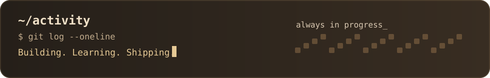

 

## About Me

I'm **Rodina**, a Computer Science student at **Egyptian Chinese University**, passionate about building practical **AI, Machine Learning, and data-driven systems**.

I enjoy working on the full journey of a project — from data preparation and model development to APIs, deployment, and usable products. My interests currently center around **AI systems, ML engineering, real-time analytics, and data pipelines**.

## Tech Stack

  
  
  
  
  
  
  
  
  
  

## Featured Projects

<table>
<tr>
<td width="33%" valign="top">
<a href="[https://github.com/rodinaasfour665-ctrl/Intelligent Student Performance System (ISPS)](https://github.com/rodinaasfour665-ctrl/ISPS-Agentic-Student-Risk-Prediction.git)">
  <b>Intelligent Student Performance System (ISPS)</b>
</a> 
Agentic academic-risk prediction platform combining <b>Fuzzy C-Means</b>, <b>SVM</b>, <b>SHAP explainability</b>, and <b>drift detection</b>, with a <b>FastAPI</b> backend for intervention workflows.
</td>
<td width="33%" valign="top">
  <a href="[https://github.com/rodinaasfour665-ctrl/PROJECT-NAME](https://github.com/rodinaasfour665-ctrl/Real-time-Traffic-Analytics.git)">
  <b>Real-Time Traffic Analytics</b>
</a> 
End-to-end traffic intelligence pipeline using <b>Azure streaming services</b>, <b>XGBoost</b>, and a <b>Streamlit</b> interface to monitor and forecast congestion across Cairo roads.
</td>
<td width="33%" valign="top">
  <a href="[https://github.com/rodinaasfour665-ctrl/PROJECT-NAME](https://github.com/rodinaasfour665-ctrl/BigData-Fraud-Detection-Pipeline.git)">
  <b>Real-Time Big Data Fraud Detection</b>
</a> 
Distributed fraud-detection pipeline built with <b>Kafka</b>, <b>Flume</b>, <b>Cassandra</b>, <b>Docker</b>, and <b>Databricks</b> for real-time transaction analysis.
</td>
</tr>
</table>

<b>Optional extra project · Social Media Fake Profile Detector</b>

 
Machine learning project focused on identifying potentially fake social media accounts using feature engineering and classification.

## Current Focus

- Building **reliable AI systems** that go beyond model demos.
- Improving my skills in **ML engineering** and **data-intensive applications**.
- Exploring practical ways to turn intelligent systems into useful products.

## GitHub Activity

  
   
  

## Let's Connect

I'm open to opportunities, collaborations, and conversations about **AI, Machine Learning, and practical engineering**.

[LinkedIn](https://www.linkedin.com/in/rodina-sabry-b79b95354) · [GitHub](https://github.com/rodinaasfour665-ctrl) · [Email](mailto:rodinaasfour665@gmail.com)
